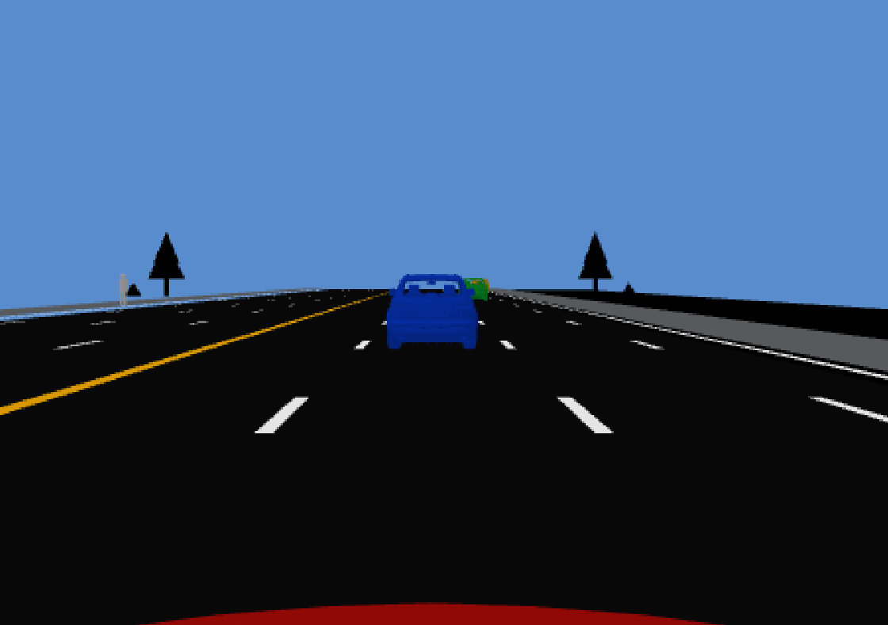
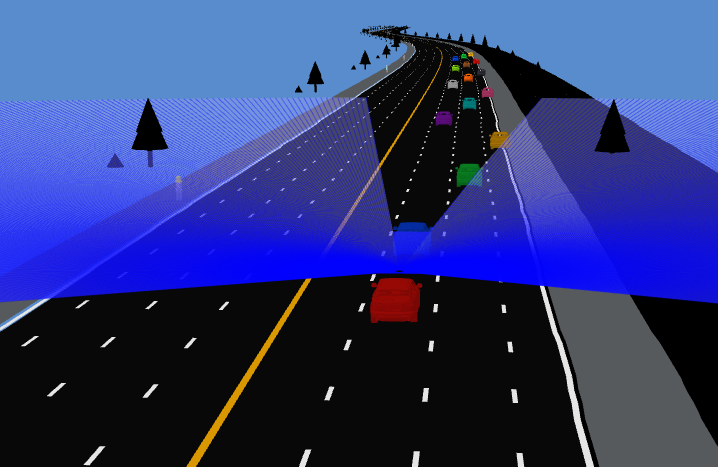

# Traffic Map — ROS 2 OpenDRIVE Simulation

This project loads an OpenDRIVE (`.xodr`) map and visualizes it with ROS 2 Humble. The primary Gazebo simulation provides a game-style ego-car view, multi-lane traffic, pedestrians, roadside scenery, lidar, radar, sonar, a dashboard camera, adverse-weather sensor simulation, obstacle avoidance, braking, and physical crash behavior.

An RViz 2 marker-based visualization is also included as a lightweight alternative.

## Features

- Complete OpenDRIVE road mesh generated from the XODR map
- Asphalt, solid edge markings, dashed lane markings, and yellow divider
- Audi Q7 GLB vehicle model converted automatically for Gazebo Classic
- Red ego vehicle with a chase camera
- 24 differently colored traffic vehicles by default, including opposing traffic
- Endless traffic recycling ahead of the ego vehicle
- Lane-aware following, safe lane changes, acceleration, braking, and obstacle avoidance
- Ego D* Lite path planning with minimum-jerk lane-change trajectories
- Timed traffic lights with green, yellow, and red signal compliance
- Posted 100 km/h speed-limit signs with controller enforcement
- Dynamic collision bodies with mass, inertia, friction, and crash physics
- Footpaths, collidable guard rails, moving pedestrians, grass, shrubs, and roadside trees
- Configurable sunlight, shadows, atmosphere, fog visibility, gravity, and wind
- Dashboard RGB camera
- 360-degree dashboard lidar with an 80 m range
- GPU front-radar approximation with a 120 m range and 90-degree FOV
- Front bumper sonar with an 8 m range
- Ego-following fog particles with physics-based camera, lidar, and radar degradation
- ROS 2 camera, `LaserScan`, `PointCloud2`, and `Range` topics

## Screenshots

### Dashboard camera



### Ego lidar



## Supported system

- Ubuntu 22.04
- ROS 2 Humble
- Gazebo Classic 11

## Install dependencies

Install ROS 2 Humble Desktop first, then install the project dependencies:

```bash
sudo apt update
sudo apt install \
  ros-humble-desktop \
  ros-humble-gazebo-ros-pkgs \
  ros-humble-rqt-image-view \
  python3-colcon-common-extensions \
  libpugixml-dev \
  libassimp-dev
```

Verify the main programs:

```bash
gazebo --version
ros2 --help
colcon --help
```

## Run the complete Gazebo simulation

From the project directory:

```bash
cd ~/Desktop/traffic_map
./run_gazebo.sh
```

The script automatically:

1. Sources ROS 2 Humble.
2. Builds the package with `colcon`.
3. Parses the XODR map.
4. Generates the road, markings, footpaths, and vegetation meshes.
5. Converts `cars/Audi_Q7_2009.glb` to a Gazebo-compatible textured OBJ.
6. Starts `gzserver` and waits for the world to initialize.
7. Starts the fog sensor model when enabled.
8. Opens the Gazebo graphical client.

Close the Gazebo window or press `Ctrl+C` in the launch terminal to stop the simulation server.

## Open the dashboard camera

Keep `run_gazebo.sh` running. In a second terminal, run:

```bash
cd ~/Desktop/traffic_map
./view_camera.sh
```

Select this image topic in `rqt_image_view`:

```text
/ego/dashboard_camera/image_raw
```

`view_camera.sh` removes incompatible Snap Core20 and Qt environment variables that can otherwise cause errors involving `/snap/core20/.../libpthread.so.0`.

## Lidar

The ego dashboard lidar currently has:

- Horizontal FOV: 360 degrees
- Range: 0.2–80 metres
- Samples: 1,080 per scan
- Update rate: 20 Hz
- Message type: `sensor_msgs/msg/LaserScan`
- Fog-affected topic: `/ego/dashboard_lidar/scan`
- Unmodified Gazebo topic: `/ego/dashboard_lidar/clear_scan`
- Frame: `dashboard_lidar`

Inspect the scan in another terminal:

```bash
source /opt/ros/humble/setup.bash
source ~/Desktop/traffic_map/install/setup.bash
ros2 topic echo /ego/dashboard_lidar/scan
```

Check its publication rate:

```bash
ros2 topic hz /ego/dashboard_lidar/scan
```

## Inspect the front sonar

The ego vehicle has a front-bumper sonar with a 30-degree horizontal cone,
an 8 m maximum range, and a 20 Hz update rate. It publishes
`sensor_msgs/msg/Range` on:

Five red emissive guide lines show the sonar coverage fan in Gazebo. These
lines are visual aids; the measured range still comes from the full ray cone.

```text
/ego/front_sonar/range
```

Display live distance measurements with:

```bash
ros2 topic echo /ego/front_sonar/range
```

Check its update rate with:

```bash
ros2 topic hz /ego/front_sonar/range
```

## Radar

The ego vehicle has a GPU ray-based front-radar approximation:

- Horizontal FOV: 90 degrees
- Range: 0.5–120 metres
- Samples: 181 per scan
- Update rate: 20 Hz
- Message type: `sensor_msgs/msg/PointCloud2`
- Raw topic: `/ego/front_radar/points`
- Fog-degraded topic: `/ego/front_radar/fog_points`
- Frame: `front_radar`

This sensor provides radar-like spatial detections for weather experiments; it
does not currently simulate Doppler velocity or radar cross section.

## Local fog and sensor degradation

By default, a 55 m long dense bank represented by 1400 translucent
"super-particles" follows the road in front of the ego. Gazebo renders these
tracers using the GPU. They follow a measured bimodal droplet distribution,
move in independently advected layers, respond to wind and synthetic
turbulence, and settle at 1.9 cm/s. Actual micrometre droplets are below screen
resolution, so each rendered tracer represents many real droplets; sensor
density comes from the microphysical extinction model rather than oversized
collision spheres. The ROS 2 fog model simultaneously applies:

- Beer–Lambert two-way extinction, range noise, intensity loss, dropouts, and
  stochastic backscatter to lidar.
- Koschmieder-style contrast loss and airlight to the RGB camera.
- Weaker two-way attenuation, detection loss, intensity loss, and range noise
  to the radar point cloud.

The clean topics remain available for direct comparison:

| Sensor | Clean topic | Fog-degraded topic |
|---|---|---|
| Camera | `/ego/dashboard_camera/image_raw` | `/ego/dashboard_camera/fog_image` |
| Lidar | `/ego/dashboard_lidar/clear_scan` | `/ego/dashboard_lidar/scan` (`/fog_scan` alias) |
| Radar | `/ego/front_radar/points` | `/ego/front_radar/fog_points` |

For exceptionally dense fog with 15 m meteorological visibility:

```bash
EGO_FOG_VISIBILITY_M=15 EGO_FOG_PARTICLES=1400 EGO_FOG_LWC_G_M3=0.7 ./run_gazebo.sh
```

For lighter fog:

```bash
EGO_FOG_VISIBILITY_M=150 EGO_FOG_PARTICLES=250 EGO_FOG_LWC_G_M3=0.08 ./run_gazebo.sh
```

Disable the local fog bank and filtering completely:

```bash
EGO_FOG_ENABLED=0 ./run_gazebo.sh
```

Available parameters:

- `EGO_FOG_ENABLED`: `1` enables fog and `0` disables it; default `1`
- `EGO_FOG_VISIBILITY_M`: meteorological visibility used to calculate optical extinction; default `20`
- `EGO_FOG_PARTICLES`: rendered super-particle count from 100–2400; default `1400`
- `EGO_FOG_LWC_G_M3`: liquid-water content; default `0.7 g/m³` for severe fog
- `EGO_FOG_TURBULENCE_MPS`: unresolved turbulent velocity; default `0.35 m/s`
- `EGO_FOG_RADAR_DB_KM_PER_G_M3`: one-way radar attenuation coefficient; default `4.2 dB/km/(g/m³)`

Use `./view_camera.sh`, then select `/ego/dashboard_camera/fog_image` to see
the filtered camera stream. Use RViz `LaserScan` and `PointCloud2` displays to
compare the clean and fog-degraded lidar and radar topics.

When fog is enabled, Gazebo's clear geometric lidar-ray debug fan is hidden
because it cannot display optical attenuation. Visualize
`/ego/dashboard_lidar/scan` in RViz to see the actual fog-affected scan. Set
RViz's fixed frame to `dashboard_lidar`. When fog is disabled, the native
Gazebo ray visualization and `/ego/dashboard_lidar/scan` are restored.

### Fog-model research basis

The default microphysics follows reported dense/radiation-fog observations:

- Droplets use a bimodal lognormal approximation centered near 2.2 and 6 μm
  radius, clamped to 0.5–20 μm. Measurements commonly place most radiation-fog
  radii below 10 μm, with mature droplets sometimes reaching 10–15 μm.
- Measurements associate approximately `0.5 g/m³` liquid-water content with
  heavy fog near 50 m visibility. The default `0.7 g/m³`, 20 m sensor preset
  deliberately represents a severe autonomous-driving test case.
- Mean settling is `1.9 cm/s`, as recommended for numerical fog prediction.
- Visible extinction uses the meteorological-visibility relationship
  `beta = 3.912 / visibility`; lidar applies the resulting extinction twice for
  the outgoing and returning beam.
- Radar attenuation is calculated from liquid-water content and is much weaker
  than optical attenuation.

References: [Klein and Dabas, 2014](https://doi.org/10.5194/amt-7-1277-2014),
[Boers et al., 2013](https://doi.org/10.1175/JTECH-D-12-00081.1),
[Kunkel, 1984](https://doi.org/10.1175/1520-0450(1984)023%3C0034:PODTVA%3E2.0.CO;2),
and [Vishwakarma et al., 2023](https://doi.org/10.5194/amt-16-1211-2023).

The radar coefficient is a configurable conservative approximation based on
warm-liquid-cloud measurements near 95 GHz; it should not be interpreted as a
calibrated 77 GHz automotive-radar propagation model.

List all ego sensor topics:

```bash
ros2 topic list | grep ego
```

## Traffic behavior

The ego requests a high cruise speed, but the posted and enforced maximum is 100 km/h (27.78 m/s). Other vehicles use different lower target speeds, vary their cruise speed gradually, and populate both the ego carriageway and opposing road lanes. Every vehicle monitors its lane and adjusts its speed according to the available distance:

- Normal acceleration is limited for smooth speed recovery.
- Cars reduce speed when approaching slower traffic.
- Emergency braking is applied at short distances.
- The ego and surrounding traffic check front and rear gaps in adjacent lanes and change lane when a safe route around slower traffic is available.
- Lane changes use a gradual lateral transition and a cooldown to prevent rapid lane oscillation.
- If no adjacent lane has a safe gap, the ego follows and brakes instead of forcing a pass.
- Traffic lights use a repeating green/yellow/red cycle. All vehicles stop for red, stop for yellow when sufficient braking distance remains, and proceed on green.
- Circular `100` signs are installed repeatedly along the route, and every vehicle controller clamps its commanded speed to 100 km/h.
- Vehicles do not intentionally pass through a car in the same lane.
- Passed vehicles remain behind for at least 100 m before being recycled ahead.
- If braking is insufficient, route control is released and Gazebo handles the collision using vehicle mass, inertia, momentum, ground contact, and friction.

### Ego path planning

The ego vehicle uses D* Lite on a rolling three-lane graph covering 300 m in
front of the car. Nearby vehicles and non-green traffic lights update the
graph costs every 0.4 seconds. The planner selects a collision-free lane path,
then a quintic minimum-jerk profile converts a lane change into smooth lateral
motion with continuous velocity and acceleration. Front and rear safety gaps
are checked before the maneuver begins. Longitudinal acceleration and braking
remain under the traffic controller, while surrounding vehicles retain the
lighter lane-following controller to avoid unnecessary CPU load.

## Change the number of vehicles

The default is 24 vehicles, including the ego. Supported values are 1–32:

```bash
TRAFFIC_VEHICLE_COUNT=8 ./run_gazebo.sh
```

Fewer vehicles reduce GPU and CPU usage.

## Configure the environment

The Gazebo world includes a visible sun disc and halo, directional sunlight, dynamic shadows, an adiabatic atmosphere, gravity, linear fog, and horizontal wind. Override the defaults when launching:

```bash
WIND_X_MPS=6.0 \
WIND_Y_MPS=2.0 \
VISIBILITY_M=400 \
SUN_LEVEL=0.75 \
./run_gazebo.sh
```

Available settings:

- `WIND_X_MPS`: wind velocity along the world X axis; default `3.0` m/s
- `WIND_Y_MPS`: wind velocity along the world Y axis; default `1.0` m/s
- `FOG_START_M`: distance from the camera where rendered fog begins; default `1.5` m
- `VISIBILITY_M`: distance where Gazebo's rendered fog becomes opaque; default `35` m
- `SUN_LEVEL`: RGB brightness of the directional sunlight; default `0.9`

For clear, calm conditions:

```bash
WIND_X_MPS=0 WIND_Y_MPS=0 VISIBILITY_M=2000 SUN_LEVEL=1.0 ./run_gazebo.sh
```

## Use another OpenDRIVE map

Pass an absolute XODR path through `FILEPATH`:

```bash
FILEPATH=/absolute/path/to/map.xodr ./run_gazebo.sh
```

The map must contain usable road geometry and lane information.

## Use another GLB car model

The default source model is:

```text
cars/Audi_Q7_2009.glb
```

Use another GLB file with:

```bash
TRAFFIC_CAR_MESH=/absolute/path/to/car.glb ./run_gazebo.sh
```

The launcher converts the GLB and extracts its embedded textures into `build/gazebo_assets/`. Models with different coordinate axes or dimensions may require pose and collision-size adjustments in `src/traffic_world_plugin.cpp`.

## Run the RViz 2 visualization

For the original ROS 2 marker visualization:

```bash
./run.sh
```

Set the RViz vehicle speed with a decimal value:

```bash
VEHICLE_SPEED_MPS=3.0 ./run.sh
```

Use another map in RViz:

```bash
FILEPATH=/absolute/path/to/map.xodr ./run.sh
```

Use a different installed ROS 2 distribution for the RViz launcher:

```bash
ROS_DISTRO=jazzy ./run.sh
```

The Gazebo workflow is developed and tested for ROS 2 Humble and Gazebo Classic 11.

## Build manually

```bash
source /opt/ros/humble/setup.bash
cd ~/Desktop/traffic_map
colcon build --symlink-install
source install/setup.bash
```

## Record sensor data

Record clean and fog-degraded sensor data:

```bash
ros2 bag record \
  /ego/dashboard_lidar/scan \
  /ego/dashboard_lidar/fog_scan \
  /ego/front_radar/points \
  /ego/front_radar/fog_points \
  /ego/front_sonar/range \
  /ego/dashboard_camera/image_raw \
  /ego/dashboard_camera/fog_image \
  /ego/dashboard_camera/camera_info
```

Stop recording with `Ctrl+C`.

## Troubleshooting

### Snap Core20 `libpthread` error

If launching `rqt_image_view` directly reports a symbol lookup error from `/snap/core20`, use:

```bash
./view_camera.sh
```

### Camera topic does not appear

Confirm that Gazebo is running, then check:

```bash
ros2 topic list | grep dashboard
```

Also check the `gzserver` terminal for errors involving `libgazebo_ros_camera.so`.

### Lidar topic does not appear

Verify that the Gazebo ROS ray plugin is installed:

```bash
ls /opt/ros/humble/lib/libgazebo_ros_ray_sensor.so
```

If it is missing:

```bash
sudo apt install ros-humble-gazebo-ros-pkgs
```

### Gazebo is slow

Reduce the traffic count:

```bash
TRAFFIC_VEHICLE_COUNT=6 ./run_gazebo.sh
```

Close RViz and other GPU-intensive applications while Gazebo is running.

### Gazebo says `Address already in use`

`run_gazebo.sh` automatically selects a free Gazebo master port, so another
Gazebo session can remain open. Close all terminals that are running an older
copy of the launcher and start it again:

```bash
./run_gazebo.sh
```

To use a specific port instead, set `GAZEBO_MASTER_URI` explicitly:

```bash
GAZEBO_MASTER_URI=http://127.0.0.1:11346 ./run_gazebo.sh
```

If you want to stop every Gazebo Classic session owned by your user first:

```bash
pkill -TERM -x gzclient || true
pkill -TERM -x gzserver || true
```

### Model database warning

The project uses a local Gazebo model database and local assets. Internet access to the public Gazebo model database is not required.
